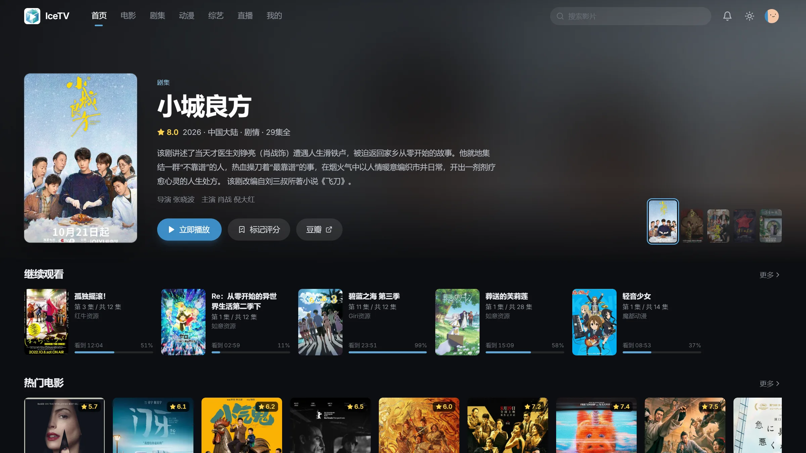
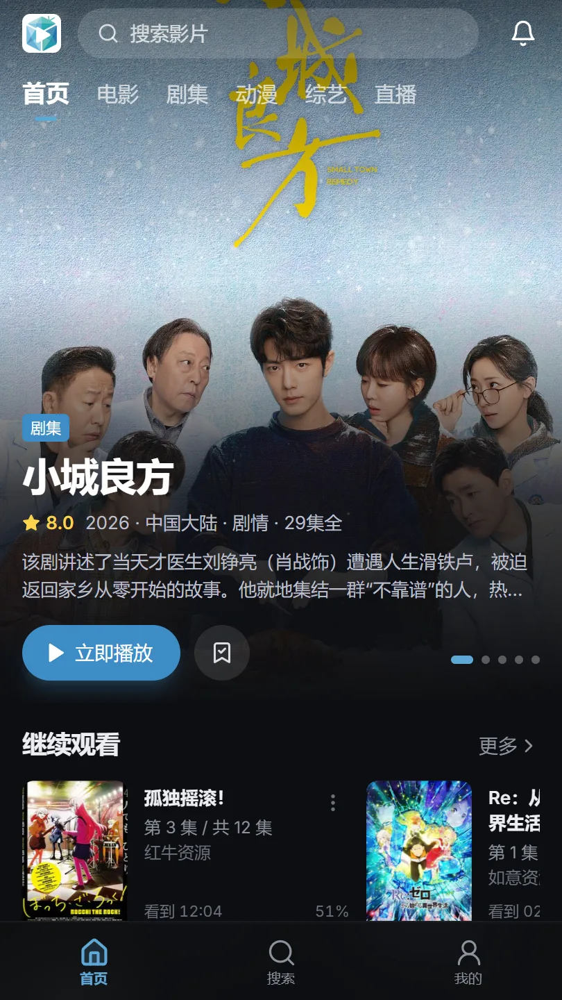
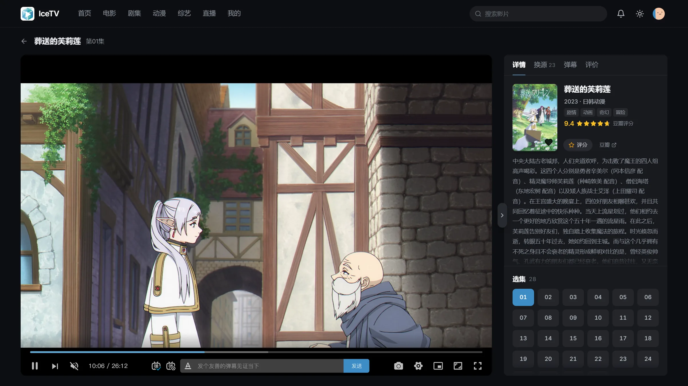
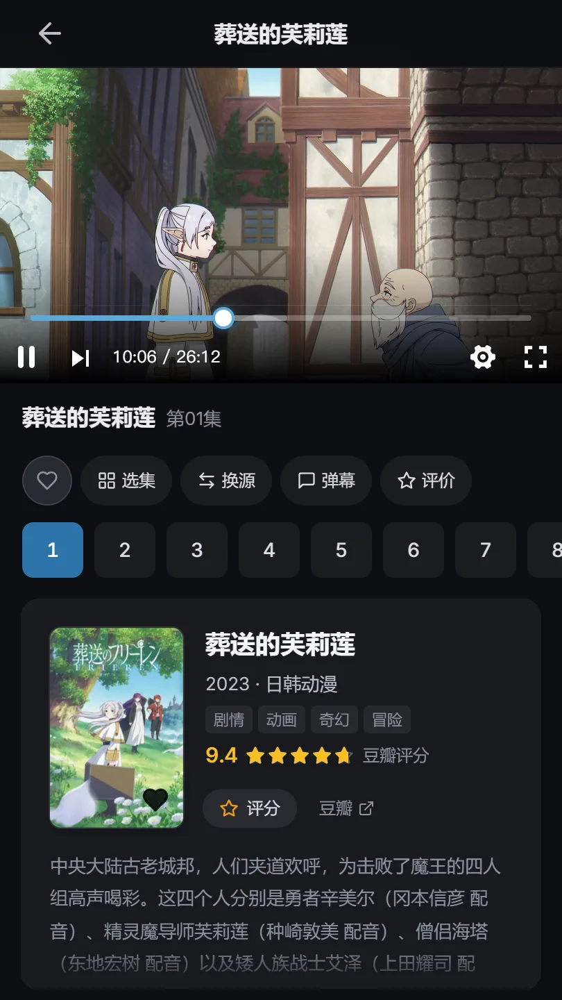
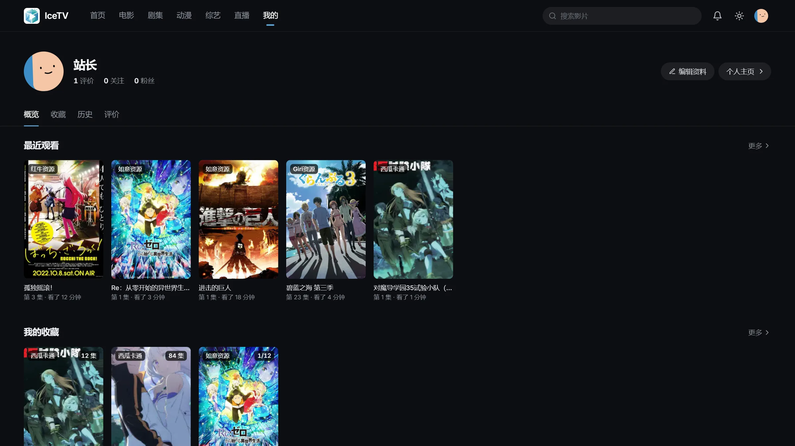
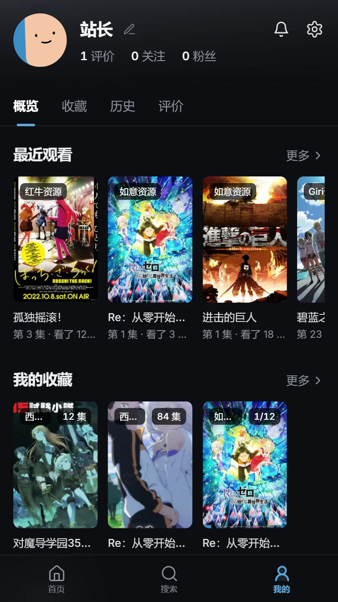

# IceTV

<div align="center">
  
</div>

> 自托管的影视聚合播放器，在多源点播与直播之上提供追更提醒、逐集进度、片单与观影记录，以及源站健康评分和回源流量管控。

<div align="center">


</div>

> [!IMPORTANT]
> 项目不内置任何播放源，部署后需在管理后台配置资源站。

> [!WARNING]
> 请勿在中国大陆社交平台宣传本项目，不授权任何"科技周刊/月刊"类项目收录。

<table>
  <tr>
    <th>桌面端</th>
    <th>移动端</th>
  </tr>
  <tr>
    <td></td>
    <td></td>
  </tr>
  <tr>
    <td></td>
    <td></td>
  </tr>
  <tr>
    <td></td>
    <td></td>
  </tr>
</table>

---

## 目录

- [功能特性](#功能特性)
- [技术栈](#技术栈)
- [部署](#部署)
- [配置文件](#配置文件)
- [环境变量](#环境变量)
- [开发](#开发)
- [客户端](#客户端)
- [安全与隐私](#安全与隐私)
- [License](#license)
- [致谢](#致谢)

## 功能特性

**追更与观看进度**

- 收藏豆瓣、Bangumi 上的连载后自动匹配可播放的源，有新集时提醒，追更区标出今天、明天或星期几更新
- 每集独立记录进度，换到集数不同的源时按集号对应；恢复到已看完的集时遵守自动连播与跳过片尾设置

**播放更稳**

- 源站按搜索与播放可用率的短板评分，参与搜索排序、起播优选与持续失效告警；同一作品近期失败的源自动排后
- 直播同频道多线路合并，展示线路健康，播放失败自动换线并记住本机可用结果
- 支持 giri、西瓜卡通、稀饭动漫等逐集解析型源站

**观影记录与社交**

- 片单：整理并公开分享，可设为游客可见，片单广场按最热或最新浏览
- 看完最后一集弹出完结卡片，可写一封观后信给未来的自己；按累计时长升级观影等级，年度报告回顾全年
- 个人主页展示本命作品与口味相合度，关注的人的评分与动态出现在播放页和消息中心

**面向站长**

- 服务器回源预算与上游出口代理池；接入 vnstat 后按月额度告警，用量接近额度时自动暂停服务器中转
- 单实例 Docker Compose 部署可在网页内升级，自动备份 SQLite，新容器启动失败时回退旧镜像
- 邀请码注册与 LinuxDo 登录，用户组按源分配权限；SQLite 与 MySQL 双后端，多实例共享缓存

## 技术栈

| 分类      | 主要依赖                                                                                              |
| --------- | ----------------------------------------------------------------------------------------------------- |
| 前端框架  | [Next.js 16](https://nextjs.org/) App Router · React 19                                               |
| UI & 样式 | [Tailwind CSS 3](https://tailwindcss.com/)                                                            |
| 语言      | TypeScript 5                                                                                          |
| 播放器    | [ArtPlayer](https://github.com/zhw2590582/ArtPlayer) · [HLS.js](https://github.com/video-dev/hls.js/) |
| 数据存储  | SQLite（better-sqlite3）· MySQL                                                                       |
| 代码质量  | ESLint · Prettier · Jest                                                                              |

## 部署

| 方案                                                 | 适用场景                     |
| ---------------------------------------------------- | ---------------------------- |
| [Docker + SQLite](docs/deployment.md#docker--sqlite) | 单机部署，数据库保存在数据卷 |
| [Docker + MySQL](docs/deployment.md#docker--mysql)   | 多实例共用数据库             |
| [Vercel + MySQL](docs/deployment.md#vercel--mysql)   | 云部署，依赖外部 MySQL       |

弹幕服务可独立接入以上任一方案，见 [接入弹幕服务](docs/deployment.md#接入弹幕服务)；升级前的备份与回退见 [升级与备份](docs/deployment.md#升级与备份)。

## 配置文件

部署后在管理后台填写配置，也可通过配置订阅从远程 JSON 同步。

```json
{
  "cache_time": 7200,
  "api_site": {
    "example": {
      "api": "http://xxx.com/api.php/provide/vod",
      "name": "示例资源"
    }
  },
  "custom_category": [
    {
      "name": "华语",
      "type": "movie",
      "query": "华语"
    }
  ],
  "lives": {
    "example": {
      "name": "示例直播",
      "url": "http://xxx.com/live.m3u"
    }
  }
}
```

| 字段              | 说明                                                                                                           |
| ----------------- | -------------------------------------------------------------------------------------------------------------- |
| `cache_time`      | 豆瓣接口浏览器缓存默认值（秒，`SiteInterfaceCacheTime`，`private max-age`）                                    |
| `api_site`        | 资源站，兼容苹果 CMS V10 API。键为唯一标识；`api` 为接口地址，`name` 为显示名称，`detail` 为可选的详情页根 URL |
| `custom_category` | 自定义分类，`type` 取 `movie` 或 `tv`，`query` 为豆瓣检索关键词                                                |
| `lives`           | 直播源。`url` 为 M3U 地址，`ua` 为可选请求 UA，`epg` 为可选节目单地址                                          |

## 环境变量

变量与默认值以 [.env.example](.env.example) 为准。签名密钥、反代层数、内网弹幕等易错配置见 [环境变量边界](docs/deployment.md#环境变量边界)。

## 开发

```bash
pnpm install
cp .env.example .env
pnpm dev
```

本地默认使用 Turbopack，遇到兼容问题改用 `pnpm dev:webpack`。开发模式默认关闭 Turbopack 磁盘缓存，热更新只走内存，避免缓存在机械盘上越积越大；项目在固态盘上时可设 `NEXT_TURBOPACK_DEV_CACHE=1` 开启，换取更快的重启。改代码前先读 [AGENTS.md](AGENTS.md)，其余工程文档见 [docs/](docs/README.md)。

## 客户端

IceTV 兼容 MoonTV 系客户端的接口，可用以下客户端登录本站，同步播放记录、收藏与搜索历史：

- [Selene](https://github.com/MoonTechLab/Selene)
- [OrionTV](https://github.com/zimplexing/OrionTV)：Android TV

本站一侧的接入要求：

1. 服务器地址填站点根地址，如 `https://tv.example.com`，不加 `/api`，客户端设备须能直接访问
2. 用本站用户名与密码登录，普通用户即可，可用源随用户组权限；经 LinuxDo 注册的账号没有可用密码，先在网页端「个人资料」中设置密码，用户名以本站显示的为准，不一定与 LinuxDo 用户名相同
3. 建议使用 HTTPS 部署：HTTPS 下登录 Cookie 带 `Secure` 标记，反向代理须透传 `Cookie` / `Set-Cookie` 并如实转发 `X-Forwarded-Proto`

客户端直接播放源站地址，不经过本站的服务器代理与线路回落；逐集解析型源站在客户端不可播放，追更、逐集进度、评价与片单仅网页端提供。客户端侧的安装与设置见各自项目说明。

## 安全与隐私

**建议仅供个人或小范围使用，不开放公网注册：**

1. `ICETV_PASSWORD` 与 `AUTH_SECRET` 使用高熵随机值
2. 注册默认关闭，需要时在后台开启并要求邀请码
3. 部署在反向代理之后时设置 `TRUSTED_PROXY_COUNT`

**声明**：本项目仅供学习和个人使用，请勿用于商业或公开服务。公开分享导致的法律问题由用户自行承担，开发者不对用户使用行为承担法律责任。本项目不在中国大陆地区提供服务，如有向该地区提供服务属个人行为，产生的法律风险及责任由用户自行承担。

## License

[CC BY-NC-SA 4.0](LICENSE) © 2025 IceTV & Contributors

## 致谢

- [ts-nextjs-tailwind-starter](https://github.com/theodorusclarence/ts-nextjs-tailwind-starter)
- [LibreTV](https://github.com/LibreSpark/LibreTV)
- [ArtPlayer](https://github.com/zhw2590582/ArtPlayer)
- [HLS.js](https://github.com/video-dev/hls.js)
- [danmu_api](https://github.com/huangxd-/danmu_api) — 弹幕服务
- [Zwei](https://github.com/bestzwei) — 豆瓣 CORS proxy
- [CMLiussss](https://github.com/cmliu) — 豆瓣 CDN
- [LINUX DO](https://linux.do) — 社区
