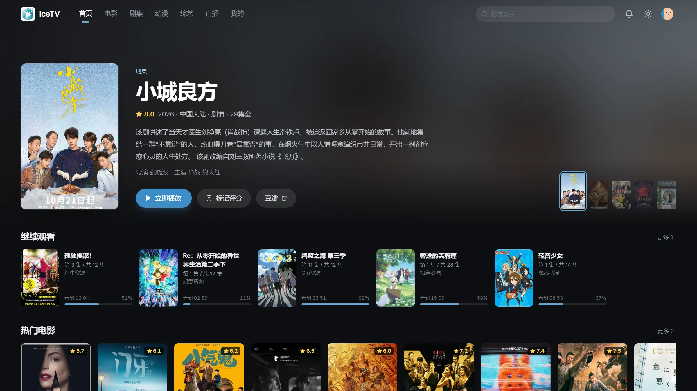
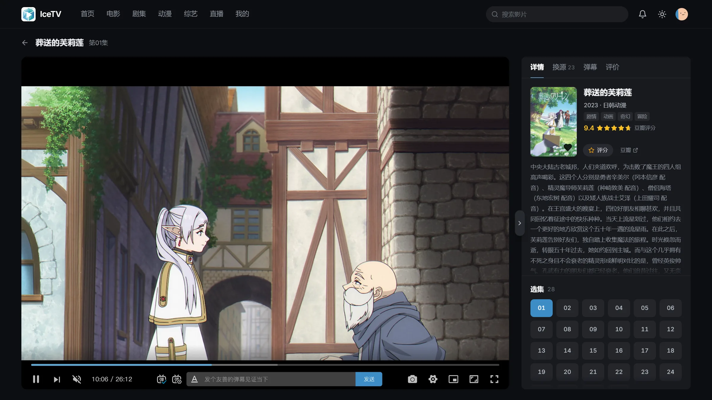
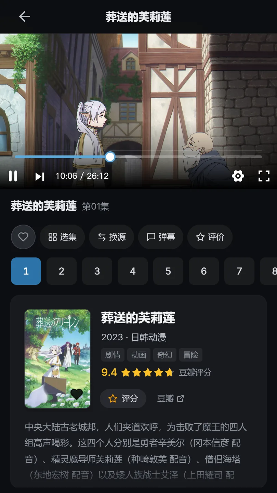
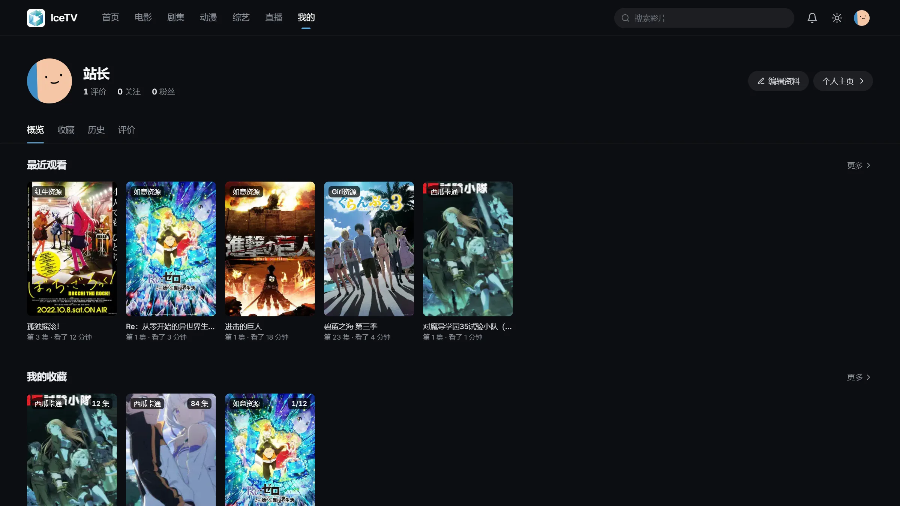
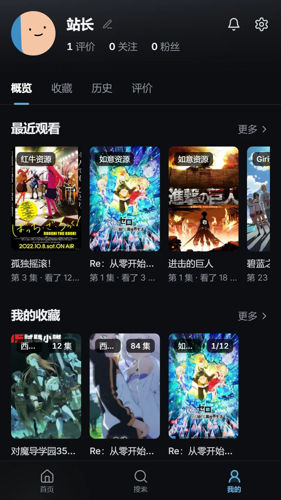

# IceTV

<div align="center">
  
</div>

> 自托管的影视聚合播放器：多源搜索、在线点播与直播、弹幕、收藏与评价，多端同步观看进度。

<div align="center">


</div>

> [!IMPORTANT]
> 项目不内置任何播放源，部署后需在管理后台配置资源站。

> [!WARNING]
> 请勿在中国大陆社交平台宣传本项目，不授权任何"科技周刊/月刊"类项目收录。

<table>
  <tr>
    <th>桌面端</th>
    <th>移动端</th>
  </tr>
  <tr>
    <td></td>
    <td></td>
  </tr>
  <tr>
    <td></td>
    <td></td>
  </tr>
  <tr>
    <td></td>
    <td></td>
  </tr>
</table>

---

## 目录

- [功能特性](#功能特性)
- [技术栈](#技术栈)
- [部署](#部署)
- [配置文件](#配置文件)
- [环境变量](#环境变量)
- [开发](#开发)
- [客户端](#客户端)
- [安全与隐私](#安全与隐私)
- [License](#license)
- [致谢](#致谢)

## 功能特性

**发现与搜索**

- 多源聚合搜索，一次返回全部资源站结果，自动记录源站健康状态
- 首页轮播与豆瓣热门电影、剧集、综艺，Bangumi 新番放送表
- 电影、剧集、动漫、综艺分类浏览与筛选，支持自定义分类

**播放**

- 基于 ArtPlayer 与 HLS.js 的点播，支持画质切换、自定义快捷键、下一集预加载
- 自动换源：起播超时或解析失败时切换到可用源
- 弹幕：对接第三方弹幕服务自动匹配，支持热力图、时间偏移与样式调节；可开启用户发送弹幕
- 智能去广告：自动跳过视频中插入的切片广告（实验性）
- 直播：导入 M3U 频道源，支持节目单

**个人与社交**

- 继续观看与播放历史，多端同步进度；观看时长统计
- 收藏库与观看状态，作品评分与短评
- 个人主页、关注与动态，消息中心推送站点公告与追更提醒

**站点管理**

- 多用户：邀请码注册、用户组按源分配权限、不活跃用户清理
- 管理后台：资源站批量管理、直播源、配置订阅、运行参数、弹幕管理与缓存观测
- PWA：可安装到桌面与手机主屏，桌面顶栏导航与移动端底部导航自适应

## 技术栈

| 分类      | 主要依赖                                                                                              |
| --------- | ----------------------------------------------------------------------------------------------------- |
| 前端框架  | [Next.js 16](https://nextjs.org/) App Router · React 19                                               |
| UI & 样式 | [Tailwind CSS 3](https://tailwindcss.com/)                                                            |
| 语言      | TypeScript 5                                                                                          |
| 播放器    | [ArtPlayer](https://github.com/zhw2590582/ArtPlayer) · [HLS.js](https://github.com/video-dev/hls.js/) |
| 数据存储  | SQLite（better-sqlite3）· MySQL                                                                       |
| 代码质量  | ESLint · Prettier · Jest                                                                              |

## 部署

| 方案                                                 | 适用场景                     |
| ---------------------------------------------------- | ---------------------------- |
| [Docker + SQLite](docs/deployment.md#docker--sqlite) | 单机部署，数据库保存在数据卷 |
| [Docker + MySQL](docs/deployment.md#docker--mysql)   | 多实例共用数据库             |
| [Vercel + MySQL](docs/deployment.md#vercel--mysql)   | 云部署，依赖外部 MySQL       |

弹幕服务可独立接入以上任一方案，见 [接入弹幕服务](docs/deployment.md#接入弹幕服务)；升级前的备份与回退见 [升级与备份](docs/deployment.md#升级与备份)。

## 配置文件

部署后在管理后台填写配置，也可通过配置订阅从远程 JSON 同步。

```json
{
  "cache_time": 7200,
  "api_site": {
    "example": {
      "api": "http://xxx.com/api.php/provide/vod",
      "name": "示例资源"
    }
  },
  "custom_category": [
    {
      "name": "华语",
      "type": "movie",
      "query": "华语"
    }
  ],
  "lives": {
    "example": {
      "name": "示例直播",
      "url": "http://xxx.com/live.m3u"
    }
  }
}
```

| 字段              | 说明                                                                                                           |
| ----------------- | -------------------------------------------------------------------------------------------------------------- |
| `cache_time`      | 豆瓣等公开接口的缓存时间（秒）                                                                                 |
| `api_site`        | 资源站，兼容苹果 CMS V10 API。键为唯一标识；`api` 为接口地址，`name` 为显示名称，`detail` 为可选的详情页根 URL |
| `custom_category` | 自定义分类，`type` 取 `movie` 或 `tv`，`query` 为豆瓣检索关键词                                                |
| `lives`           | 直播源。`url` 为 M3U 地址，`ua` 为可选请求 UA，`epg` 为可选节目单地址                                          |

## 环境变量

变量与默认值以 [.env.example](.env.example) 为准。签名密钥、反代层数、内网弹幕等易错配置见 [环境变量边界](docs/deployment.md#环境变量边界)。

## 开发

```bash
pnpm install
cp .env.example .env
pnpm dev
```

本地默认使用 Turbopack，遇到兼容问题改用 `pnpm dev:webpack`。开发模式默认关闭 Turbopack 磁盘缓存，热更新只走内存，避免缓存在机械盘上越积越大；项目在固态盘上时可设 `NEXT_TURBOPACK_DEV_CACHE=1` 开启，换取更快的重启。改代码前先读 [AGENTS.md](AGENTS.md)，其余工程文档见 [docs/](docs/README.md)。

## 客户端

- [Selene](https://github.com/MoonTechLab/Selene)：配合使用，数据同步
- [OrionTV](https://github.com/zimplexing/OrionTV)：Android TV 客户端，播放记录同步

## 安全与隐私

**建议仅供个人或小范围使用，不开放公网注册：**

1. `ICETV_PASSWORD` 与 `AUTH_SECRET` 使用高熵随机值
2. 注册默认关闭，需要时在后台开启并要求邀请码
3. 部署在反向代理之后时设置 `TRUSTED_PROXY_COUNT`

**声明**：本项目仅供学习和个人使用，请勿用于商业或公开服务。公开分享导致的法律问题由用户自行承担，开发者不对用户使用行为承担法律责任。本项目不在中国大陆地区提供服务，如有向该地区提供服务属个人行为，产生的法律风险及责任由用户自行承担。

## License

[CC BY-NC-SA 4.0](LICENSE) © 2025 IceTV & Contributors

## 致谢

- [ts-nextjs-tailwind-starter](https://github.com/theodorusclarence/ts-nextjs-tailwind-starter)
- [LibreTV](https://github.com/LibreSpark/LibreTV)
- [ArtPlayer](https://github.com/zhw2590582/ArtPlayer)
- [HLS.js](https://github.com/video-dev/hls.js)
- [Zwei](https://github.com/bestzwei) — 豆瓣 CORS proxy
- [CMLiussss](https://github.com/cmliu) — 豆瓣 CDN
